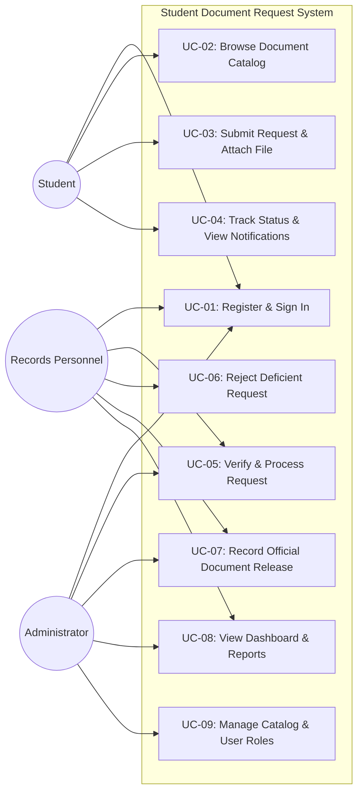

# Use-Case Model & Interface Wireframes
**Project:** Student Document Request, Processing, and Release Management System

---

## 1. Use-Case Diagram



---

## 2. Essential Use-Case Descriptions

### UC-01: Register and Sign In
* **Actors**: Student, Records Personnel, Administrator
* **Preconditions**: User has the Flutter Android app installed or opens `/staff/login/` in a browser.
* **Main Flow**:
  1. New students tap **Register Here**, enter Student ID, name, course, year level, email, username, and password, and submit.
  2. Existing users enter username and password and tap **Sign In**.
  3. Django authenticates credentials and returns an auth token and user role.
  4. The Flutter app saves the token in encrypted storage and routes `STUDENT` to the Student Dashboard or `RECORDS_STAFF`/`ADMIN` to the Staff Dashboard.
* **Alternate Flow**: Invalid credentials return `401 Unauthorized` and display an error message. Expired tokens automatically clear local storage and return the user to Sign In.

### UC-02 & UC-03: Browse Catalog and Submit Document Request
* **Actor**: Student
* **Preconditions**: Student is signed in.
* **Main Flow**:
  1. Student opens the **New Request** tab.
  2. App loads active `DocumentType` entries from `GET /api/types/` showing fee, processing days, and required documents.
  3. Student selects a document type, sets number of copies (1–5), chooses delivery method (`PICKUP`, `COURIER`, `DIGITAL_COPY`), enters purpose, and optionally attaches a supporting file (PDF/JPG/PNG, ≤ 5 MB).
  4. Student taps **Submit Request** (`POST /api/requests/`).
  5. Backend persists the record in PostgreSQL, generates a unique tracking number (`DOC-YYYYMM-XXXXXX`), logs the initial `SUBMITTED` history entry, creates a confirmation notification, and displays the tracking code dialog.
* **Alternate Flow**: Empty purpose or invalid file format displays a validation error before/during submission.

### UC-04: Track Status and View Notifications
* **Actor**: Student
* **Preconditions**: Student has submitted at least one request.
* **Main Flow**:
  1. Student opens the **Requests** tab and optionally filters by status chip.
  2. Student taps a request card to view `RequestDetailScreen`, displaying current status badge, purpose, attachments, release details, and the full timestamped **Status Timeline**.
  3. Student opens the **Alerts** tab to review in-app notifications triggered by staff actions.

### UC-05: Verify and Process Request
* **Actor**: Records Personnel / Administrator
* **Preconditions**: Staff is signed into the Web Staff Portal (`/staff/dashboard/`) or Mobile Staff mode.
* **Main Flow**:
  1. Staff searches or filters the queue for `SUBMITTED` requests and clicks **Review & Process**.
  2. Staff inspects student details, purpose, and attachments, then clicks **Start Verification** (`SUBMITTED → UNDER_VERIFICATION`).
  3. Once clearances are confirmed, staff clicks **Send to Processing & Printing** (`UNDER_VERIFICATION → FOR_PROCESSING`).
  4. When the physical document is printed and stamped, staff clicks **Mark as Ready for Release** (`FOR_PROCESSING → READY_FOR_RELEASE`) with counter pickup notes.
  5. Each transition logs a `RequestStatusHistory` entry and notifies the student.

### UC-06: Reject Deficient Request
* **Actor**: Records Personnel / Administrator
* **Preconditions**: Request is not yet in a terminal state (`RELEASED` or `REJECTED`).
* **Main Flow**:
  1. Staff clicks **Reject Deficient Request** and enters the deficiency reason (e.g., *"Unsettled library clearance"*).
  2. System transitions status to `REJECTED`, stores `rejection_reason`, records history, and sends an alert notification to the student.

### UC-07: Record Official Document Release
* **Actor**: Records Personnel / Administrator
* **Preconditions**: Request status is `READY_FOR_RELEASE`.
* **Main Flow**:
  1. Staff clicks **Record Official Release Transaction**.
  2. Staff enters/confirms `recipient_name`, `delivery_method`, and `release_notes` (e.g., Counter 2 verification).
  3. System transitions status to `RELEASED`, stamps `released_at`, logs audit history, and notifies the student.

### UC-08: View Dashboard and Processing Reports
* **Actor**: Records Personnel / Administrator
* **Main Flow**: Staff opens `/staff/dashboard/` (web) or the **Analytics** tab (mobile) to view real-time counts for Total Requests, Under Verification, For Processing, Ready for Release, Released, and Rejected.

---

## 3. Low-Fidelity Interface Wireframes

### A. Mobile Student Screens (Flutter)

```text
+---------------------------+   +---------------------------+   +---------------------------+
|   Student Document Portal |   |   My Document Requests    |   |  Request Academic Doc     |
|                           |   | [All][Submitted][Ready]   |   |                           |
|       [ School Icon ]     |   | +-----------------------+ |   | Select Document Type      |
|                           |   | | Official TOR          | |   | [ Official TOR (150)  v ] |
| [ Username              ] |   | | DOC-202611-A1B2C3     | |   | [i] Est: 7 business days  |
| [ Password              ] |   | | Copies: 2 • PHP 150   | |   |                           |
|                           |   | |       [For Processing]| |   | Copies:    (-)  1  (+)    |
| [       Sign In         ] |   | +-----------------------+ |   | Delivery: [ Pickup    v ] |
| [Student Demo][Staff Demo]|   | +-----------------------+ |   | Purpose:                  |
|                           |   | | Certificate of Enroll | |   | [ For job application   ] |
|  No account? Register     |   | | DOC-202611-D4E5F6     | |   | Attachment (PDF/JPG/PNG): |
|                           |   | |    [Ready for Release]| |   | [ + Attach Requirement  ] |
|                           |   | +-----------------------+ |   | [    Submit Request     ] |
+---------------------------+   +---------------------------+   +---------------------------+
                                |Req | New | Alerts | Prof  |   |Req | New | Alerts | Prof  |
                                +---------------------------+   +---------------------------+
```

### B. Web Staff Portal (Django + Bootstrap 5)

```text
+--------------------------------------------------------------------------------------+
| [Logo] University Records Office    Dashboard | API Docs | Django Admin   [Staff Out]|
+--------------------------------------------------------------------------------------+
| [Total: 12]  [Verification: 3]  [Processing: 4]  [Ready: 2]  [Released: 3]           |
+--------------------------------------------------------------------------------------+
| Document Requests Queue                              [ Search tracking / student ]   |
| (All) (Submitted) (Under Verification) (Processing) (Ready) (Released) (Rejected)    |
|--------------------------------------------------------------------------------------|
| Tracking #       | Student         | Document        | Status       | Action         |
| DOC-202611-A1B2  | Juan Dela Cruz  | Official TOR    | [Processing] | [Review/Proc]  |
| DOC-202611-D4E5  | Juan Dela Cruz  | Cert of Enroll  | [Ready]      | [Review/Proc]  |
+--------------------------------------------------------------------------------------+
```
