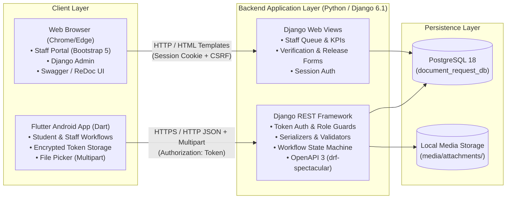
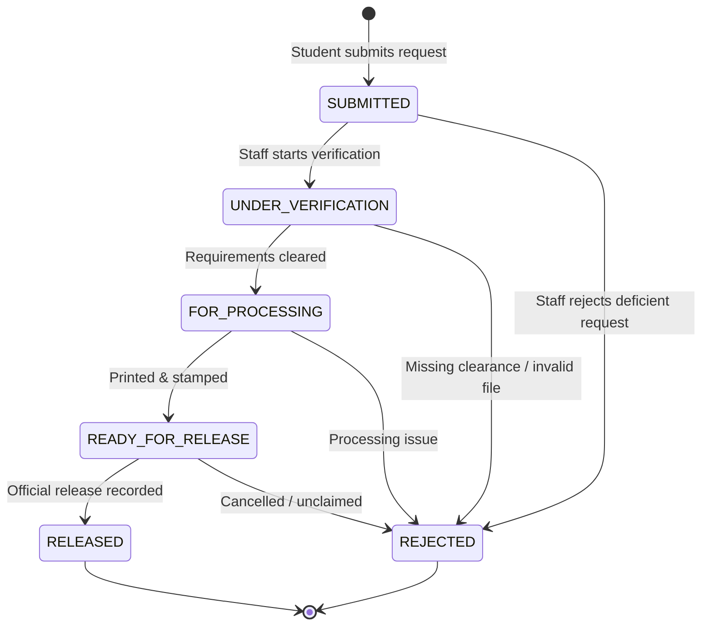
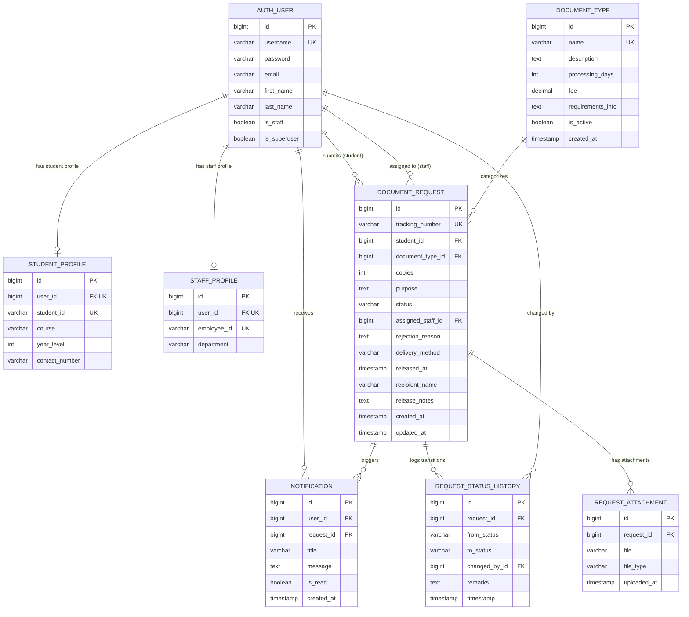

# System Architecture, ERD & Data Dictionary
**Project:** Student Document Request, Processing, and Release Management System

---

## 1. System Architecture Diagram

---

## 2. Document Request Workflow State Machine

---

## 3. Entity-Relationship Diagram (ERD)

---

## 4. Data Dictionary

### Table: `documents_studentprofile`
| Column | Data Type | Constraints | Description |
| :--- | :--- | :--- | :--- |
| `id` | `BIGSERIAL` | PK | Auto-increment primary key |
| `user_id` | `BIGINT` | FK (`auth_user.id`), UNIQUE, NOT NULL | Links 1-to-1 with Django user account |
| `student_id` | `VARCHAR(50)` | UNIQUE, NOT NULL | Official university student number (e.g., `2023-10492`) |
| `course` | `VARCHAR(150)` | NOT NULL | Enrolled degree program |
| `year_level` | `INTEGER` | DEFAULT `1`, NOT NULL | Current academic year level (1–5) |
| `contact_number` | `VARCHAR(20)` | DEFAULT `''` | Student mobile contact number |

### Table: `documents_staffprofile`
| Column | Data Type | Constraints | Description |
| :--- | :--- | :--- | :--- |
| `id` | `BIGSERIAL` | PK | Auto-increment primary key |
| `user_id` | `BIGINT` | FK (`auth_user.id`), UNIQUE, NOT NULL | Links 1-to-1 with staff Django account |
| `employee_id` | `VARCHAR(50)` | UNIQUE, NOT NULL | Employee identifier (e.g., `EMP-002`) |
| `department` | `VARCHAR(100)` | DEFAULT `'Registrar / Records Office'` | Assigned office/section |

### Table: `documents_documenttype`
| Column | Data Type | Constraints | Description |
| :--- | :--- | :--- | :--- |
| `id` | `BIGSERIAL` | PK | Auto-increment primary key |
| `name` | `VARCHAR(150)` | UNIQUE, NOT NULL | Document title (e.g., *Official Transcript of Records*) |
| `description` | `TEXT` | DEFAULT `''` | Summary of the document |
| `processing_days` | `INTEGER` | UNSIGNED, DEFAULT `3` | Estimated turnaround time in business days |
| `fee` | `NUMERIC(8,2)` | DEFAULT `0.00` | Processing fee in PHP |
| `requirements_info` | `TEXT` | NOT NULL | Required clearances or proofs |
| `is_active` | `BOOLEAN` | DEFAULT `TRUE` | Controls visibility in student catalog |
| `created_at` | `TIMESTAMPTZ` | AUTO_NOW_ADD | Record creation timestamp |

### Table: `documents_documentrequest`
| Column | Data Type | Constraints | Description |
| :--- | :--- | :--- | :--- |
| `id` | `BIGSERIAL` | PK | Auto-increment primary key |
| `tracking_number` | `VARCHAR(32)` | UNIQUE, NOT NULL | Auto-generated code (`DOC-YYYYMM-XXXXXX`) |
| `student_id` | `BIGINT` | FK (`auth_user.id`), CASCADE | Requesting student |
| `document_type_id` | `BIGINT` | FK (`documents_documenttype.id`), PROTECT | Requested document type |
| `copies` | `INTEGER` | UNSIGNED, DEFAULT `1` | Requested copy count (validated 1–10) |
| `purpose` | `TEXT` | NOT NULL | Stated purpose of request |
| `status` | `VARCHAR(30)` | DEFAULT `'SUBMITTED'` | Current workflow state |
| `assigned_staff_id` | `BIGINT` | FK (`auth_user.id`), SET NULL, NULLABLE | Records staff handling the request |
| `rejection_reason` | `TEXT` | DEFAULT `''` | Explanation when `status = REJECTED` |
| `delivery_method` | `VARCHAR(20)` | DEFAULT `'PICKUP'` | `PICKUP`, `COURIER`, or `DIGITAL_COPY` |
| `released_at` | `TIMESTAMPTZ` | NULLABLE | Timestamp when document was officially released |
| `recipient_name` | `VARCHAR(150)` | DEFAULT `''` | Name of person who claimed/received the document |
| `release_notes` | `TEXT` | DEFAULT `''` | Counter number, ID check, or courier notes |
| `created_at` | `TIMESTAMPTZ` | AUTO_NOW_ADD | Submission timestamp |
| `updated_at` | `TIMESTAMPTZ` | AUTO_NOW | Last modification timestamp |

### Table: `documents_requestattachment`
| Column | Data Type | Constraints | Description |
| :--- | :--- | :--- | :--- |
| `id` | `BIGSERIAL` | PK | Auto-increment primary key |
| `request_id` | `BIGINT` | FK (`documents_documentrequest.id`), CASCADE | Parent document request |
| `file` | `VARCHAR(100)` | NOT NULL | Relative path under `media/attachments/%Y/%m/` |
| `file_type` | `VARCHAR(100)` | DEFAULT `'Supporting Document'` | Label for uploaded requirement |
| `uploaded_at` | `TIMESTAMPTZ` | AUTO_NOW_ADD | Upload timestamp |

### Table: `documents_requeststatushistory`
| Column | Data Type | Constraints | Description |
| :--- | :--- | :--- | :--- |
| `id` | `BIGSERIAL` | PK | Auto-increment primary key |
| `request_id` | `BIGINT` | FK (`documents_documentrequest.id`), CASCADE | Parent document request |
| `from_status` | `VARCHAR(30)` | DEFAULT `''` | Previous status before transition |
| `to_status` | `VARCHAR(30)` | NOT NULL | New status after transition |
| `changed_by_id` | `BIGINT` | FK (`auth_user.id`), SET NULL, NULLABLE | User who performed the action |
| `remarks` | `TEXT` | DEFAULT `''` | Staff notes or automated message |
| `timestamp` | `TIMESTAMPTZ` | AUTO_NOW_ADD | Exact time of transition |

### Table: `documents_notification`
| Column | Data Type | Constraints | Description |
| :--- | :--- | :--- | :--- |
| `id` | `BIGSERIAL` | PK | Auto-increment primary key |
| `user_id` | `BIGINT` | FK (`auth_user.id`), CASCADE | Recipient user |
| `request_id` | `BIGINT` | FK (`documents_documentrequest.id`), CASCADE, NULLABLE | Related document request |
| `title` | `VARCHAR(200)` | NOT NULL | Notification headline |
| `message` | `TEXT` | NOT NULL | Notification body |
| `is_read` | `BOOLEAN` | DEFAULT `FALSE` | Read/unread flag |
| `created_at` | `TIMESTAMPTZ` | AUTO_NOW_ADD | Creation timestamp |
